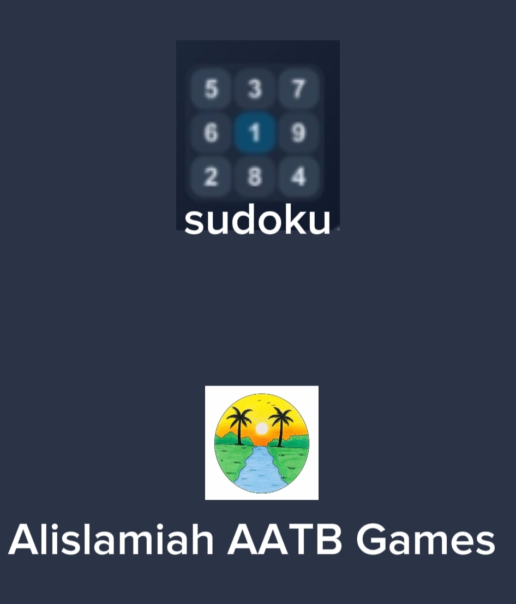
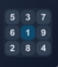

<!DOCTYPE html>
<html lang="en">
<head>
<meta charset="UTF-8">
<meta name="viewport" content="width=device-width, initial-scale=1.0">
<meta name="theme-color" content="#070d1b">

<title>Sudoku | Alislamiah AATB Games</title>
<link rel="icon" href="icon.png">

<link href="https://fonts.googleapis.com/css2?family=Inter:wght@400;500;600;700;800;900&display=swap" rel="stylesheet">

</head>

<body>

    

<header>

    

        

        

            <h2>Sudoku</h2>
            
ALISLAMIAH AATB GAMES

        

    

    

        BRAIN GAMES
    

</header>

<main>

    <section class="welcome">

        
WELCOME TO SUDOKU

        <h1>
            Challenge Your 
            Mind.
        </h1>

        

            Train your brain, improve your logic 
            and become a Sudoku master.
        

    </section>

    <a href="learn.html" class="learn-card">

        

            
📘

            

                <h3>You're beginner? Learn Sudoku ♂️</h3>
                
Learn the rules and start your journey

            

        

        
›

    </a>

    <section>

        

            <h2>Play as</h2>
            
Choose your difficulty level

        

        

            <button class="level easy"
            onclick="startGame('easy')">

                
🌱

                

                    <h3>Easy</h3>
                    
Perfect for beginners

                

            </button>

            <button class="level medium"
            onclick="startGame('medium')">

                
⚡

                

                    <h3>Medium</h3>
                    
Test your logic skills

                

            </button>

            <button class="level hard"
            onclick="startGame('hard')">

                
🔥

                

                    <h3>Hard</h3>
                    
For Sudoku experts

                

            </button>

        

    </section>

</main>

<footer>
    Powered by Alislamiah AATB Games 
    © 2026 All rights reserved.
</footer>

</body>
</html>
